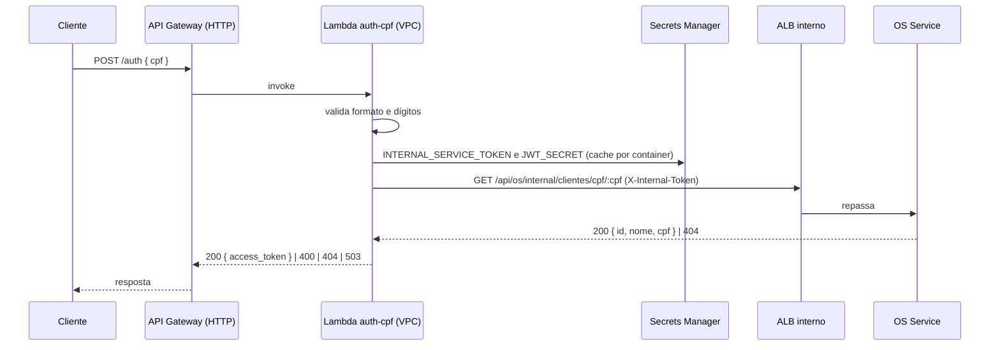

# tc-fase4-auth — Autenticação por CPF

[](https://sonarcloud.io/summary/new_code?id=Os-Desacoplados-Pos-Tech-SOAP-FIAP_tc-fase4-auth)
[](https://sonarcloud.io/summary/new_code?id=Os-Desacoplados-Pos-Tech-SOAP-FIAP_tc-fase4-auth)
[](https://sonarcloud.io/summary/new_code?id=Os-Desacoplados-Pos-Tech-SOAP-FIAP_tc-fase4-auth)
[](https://sonarcloud.io/summary/new_code?id=Os-Desacoplados-Pos-Tech-SOAP-FIAP_tc-fase4-auth)
[](https://sonarcloud.io/summary/new_code?id=Os-Desacoplados-Pos-Tech-SOAP-FIAP_tc-fase4-auth)

Autenticação **serverless** do cliente da oficina pelo CPF. São duas funções Lambda:

- **`auth-cpf`** (`POST /auth` no API Gateway): valida o CPF, confere no OS Service se o cliente existe e emite o
  JWT do cliente.
- **`authorizer-cliente`**: Lambda authorizer do API Gateway que valida esse JWT nas rotas `/api/os/publico/*`.

A Lambda **não acessa banco**. O dono dos dados do cliente é o OS Service, e a Lambda consulta a rota interna dele.

Stack: Node.js 22 (`nodejs22.x`), TypeScript, esbuild, Jest, jsonwebtoken, AWS SDK v3 (Secrets Manager), Terraform.

## Fluxo



### Respostas do `POST /auth`

| Status | `code` | Quando |
|---|---|---|
| 200 | — | `{ access_token, token_type: "Bearer", expires_in: 3600, cliente: { id, nome } }` |
| 400 | `BODY_INVALIDO` | body não é JSON |
| 400 | `CPF_INVALIDO` | CPF ausente, com tamanho errado ou dígito verificador inválido |
| 404 | `CLIENTE_NAO_ENCONTRADO` | o OS respondeu 404 |
| 503 | `OS_INDISPONIVEL` | o OS respondeu erro (401, 5xx) ou não respondeu em 3 s |
| 500 | `CONFIGURACAO_AUSENTE` | falta a variável `OS_INTERNAL_URL` |

## Contrato do token

JWT **HS256**, assinado com o mesmo `JWT_SECRET` dos serviços, validade de **1 hora**:

```json
{ "sub": "<id do cliente>", "perfil": "CLIENTE", "iat": 0, "exp": 0 }
```

É o mesmo contrato `{sub, perfil}` dos tokens de funcionário (`perfil ∈ {CLIENTE, ATENDENTE, MECANICO, ADMINISTRADOR}`),
então os serviços validam os dois tipos do mesmo jeito.

**Por que não há CPF no token:** o JWT só é assinado, não é cifrado. Qualquer um com o token lê o payload em base64.
Colocar o CPF ali espalharia um dado pessoal por logs, proxies e pelo navegador sem necessidade (LGPD, minimização).
O `sub` basta para o OS localizar o cliente. Na Fase 3 o token levava `cpf` e `scope`; na Fase 4 isso saiu.

### Authorizer

Usado pelo API Gateway (HTTP API, payload 2.0, resposta simples) só nas rotas `/api/os/publico/*`. Autoriza quando o
header `Authorization: Bearer <token>` tem assinatura válida (somente HS256), não expirou e tem `perfil === "CLIENTE"`.
Token de funcionário, sem `Bearer` ou com segredo errado é negado. O contexto repassado é `{ sub, perfil }`.

## Configuração

### Variáveis de ambiente

| Função | Variável | Padrão | Uso |
|---|---|---|---|
| auth-cpf | `OS_INTERNAL_URL` | — (obrigatória) | `http://<DNS do ALB interno>`, preenchida pelo Terraform |
| auth-cpf | `INTERNAL_SERVICE_TOKEN_SECRET_ID` | `oficina-fase4/INTERNAL_SERVICE_TOKEN` | nome do segredo do token interno |
| auth-cpf, authorizer | `JWT_SECRET_ID` | `oficina-fase4/JWT_SECRET` | nome do segredo do JWT |

### Segredos

Os dois segredos são **criados em `tc-fase4-infra`** (`random_password` no Secrets Manager) e só lidos aqui. A role da
Lambda tem `secretsmanager:GetSecretValue` restrito a esses dois ARNs. Nenhum valor fica no repositório ou nos logs.

## Rede

- `auth-cpf` roda nas **subnets privadas** da VPC do cluster, com um SG próprio (egress livre: Secrets Manager via NAT e
  ALB interno).
- O ALB é **interno** (IngressGroup `oficina-fase4`). O SG dele é gerenciado em `tc-fase4-infra` (output
  `alb_security_group_id`); este repo adiciona a regra de **entrada na porta 80 a partir do SG da Lambda**.
- A Lambda chama o ALB direto, sem passar pelo API Gateway. No gateway, `/api/os/internal/*` exige `AWS_IAM` e devolve
  403 para quem vem de fora.
- `authorizer-cliente` fica **fora da VPC**: só valida assinatura, e assim o cold start é menor.

O ALB é localizado pelas tags que o AWS Load Balancer Controller põe nele
(`elbv2.k8s.aws/cluster = <cluster>` e `ingress.k8s.aws/stack = oficina-fase4`).

## Runtime

`nodejs22.x` (bundle com `--target=node22`). Segundo a
[tabela de runtimes do Lambda](https://docs.aws.amazon.com/lambda/latest/dg/lambda-runtimes.html), consultada em
17/10/2026, o `nodejs20.x` usado na Fase 3 foi depreciado em 30/04/2026, e o `nodejs22.x` tem depreciação prevista
para 30/04/2027 (bloqueio de criação em 29/07/2027).

## Ordem de deploy

O Terraform lê o state da infra (`infra/terraform.tfstate`) e procura o ALB do IngressGroup. O ALB só existe depois
que algum serviço aplicou o seu Ingress, então a ordem é:

1. `tc-fase4-infra` (VPC, EKS, SG do ALB, segredos);
2. deploy dos serviços no EKS (cria o ALB interno);
3. **este repo** (Lambdas);
4. gateway em `tc-fase4-infra/gateway` (lê os outputs deste state).

Na descida, a ordem é a inversa.

## Esteira (CI/CD)

| Evento | Job | O que faz |
|---|---|---|
| Pull request e push na `main` | `ci` | `npm ci`, lint, testes com cobertura (≥ 80%), build, `terraform fmt -check`, `init -backend=false`, `validate`, SonarCloud |
| Botão Actions (`workflow_dispatch`) | `deploy` | `plan`, `apply` ou `destroy`, com aprovação no environment `aws-infra` |

Merge na `main` **não** faz deploy. O `plan` não roda no CI porque depende do state da infra e do ALB dos serviços.
A credencial AWS vem por **OIDC** (role `gha-tc-fase4-auth`), sem chave de acesso no repositório.

## Como testar

```bash
npm ci
npm run lint
npm run test:cov   # Jest com cobertura mínima de 80%
npm run build      # gera dist/auth/index.js e dist/authorizer/index.js

terraform -chdir=terraform fmt -check
terraform -chdir=terraform init -backend=false
terraform -chdir=terraform validate
```

Depois do deploy:

```bash
curl -s -X POST "$API_URL/auth" -H 'content-type: application/json' -d '{"cpf":"529.982.247-25"}'
```

### Qualidade e cobertura

Painel do projeto no SonarCloud: <https://sonarcloud.io/summary/overall?id=Os-Desacoplados-Pos-Tech-SOAP-FIAP_tc-fase4-auth>.
O SonarCloud analisa todo PR e o check `SonarCloud Code Analysis` (quality gate) é obrigatório para merge na `main`.

## Estrutura

```
src/
  auth.handler.ts        # POST /auth
  authorizer.handler.ts  # Lambda authorizer
  cpf.ts                 # limpeza e dígitos verificadores
  jwt.ts                 # emissão e validação do token do cliente
  os-client.ts           # rota interna do OS (timeout de 3 s)
  secrets.ts             # Secrets Manager com cache
terraform/               # Lambdas, role, SG e regra no SG do ALB
```

## Repositórios relacionados

- [tc-fase4-infra](https://github.com/Os-Desacoplados-Pos-Tech-SOAP-FIAP/tc-fase4-infra) — VPC, EKS, ECR, segredos e API Gateway
- [tc-fase4-os](https://github.com/Os-Desacoplados-Pos-Tech-SOAP-FIAP/tc-fase4-os) — OS Service (dono dos dados do cliente)
